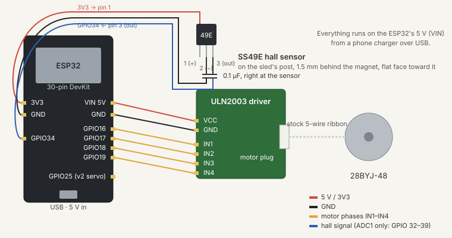

# Hardware

Design goal: **as cheap and as 3D-printable as possible.** A low, horizontal caliper-style press, about 7 cm tall. Every structural and mechanical part is printed, including the lead screw, the guide channel, the force-sensing blade and the avocado nest. No bearings, no metal load cell, no power brick.

Interactive 3D assembly (orbit, explode, simulated reading): https://claude.ai/artifact/XxPCr4hXQnpZJonZaod3w8

**Print files:** [`stl/`](stl/) with print settings and the assembly order. CAD: Fusion 360 design `BTL Ripe-O-Matic` (export on request). Everything fits a 180 × 180 mm bed.

## Layout

```
 side view (press axis left → right)

  motor ─ screw ────▶ [sled] ─ blade ─ pad ─▶ ( avocado )╮ nest
  └──────── guide channel in base ─────────┘  yoke arm ┤o── pin at fruit centre
 ═══════════════════════ base plate ═══════════════════════
```

The avocado lies in a printed half-shell nest with a soft liner, opening toward the pad. The sled drives a soft pad on a short stem into the fruit's side, pushing it into the curved back of the nest. Pressing sideways means the reaction spreads over the nest's whole back wall instead of cradle pins, the whole thing stays low, and gravity acts perpendicular to the measurement. The nest hangs between two yoke arms on M5 pins at the height of the pad, so the pivot axis runs through the avocado's centre of gravity. In v1 the pins are tight; in v2 a servo on one pin swings the nest back to drop a ripe avocado into a bowl below.

## Printed parts

All PLA or PETG unless noted. Roughly 150 g of filament total.

| Part | Qty | Print notes |
|---|---|---|
| Base plate | 1 | Flat, 165 × 165 × 5 mm with lightening windows. One print carries the guide channel (two rails with 2 mm inward lips), motor plate with gussets, end stop, a 3 mm recess for the U-yoke, and two pairs of keyhole studs at the motor end, one each side of the channel, for the two electronics boxes. The nest hangs clear of the base; the v2 servo overhangs the edge by a few mm, which is fine. |
| ESP32 case | 1 | BTL's *ESP32 case for the ELEGOO DevKit v6* ([`stl/esp32-case/`](stl/esp32-case/)): base, snap lid with a flexing key and an MX keycap over the BOOT button, USB-C opening in one end, keyholes in the floor. Slides onto the board-side studs with the USB end toward the motor. |
| Driver box | 1 | 48 × 37 × 26 mm box for the ULN2003 with the same keyholes, board ledges, two wire notches and a snap lid with hold-down pegs and vents. Slides onto the studs on the far side of the channel. |
| | | The studs and keyholes are the *BTL universal mount*, shared with other BTL projects, so any box with those two keyholes fits either spot: [`keyhole-mount.md`](keyhole-mount.md). |
| Avocado V-holder | 1 | A fixed corner the avocado lies in: a floor tilted 12° down toward the back and a wall square to it, 120 mm between its end walls, ribs underneath. Any avocado about 55–80 mm across touches both faces, so the push wedges it in instead of rolling it; an 80 mm one has its middle at pad height. A foot drops into the base's slot at the avocado end and takes four M3 screws from below. Replaces the nest, U-yoke, knob and bolts below (kept for the first build). `tools/v_holder.py`. |
| Avocado nest | 1 | An avocado-shell scoop with flat ends: the back half of a spheroid shell, ends cut flat 132 mm apart, top cut off 15° above the equator so the fruit rolls out after ~110° of tip (a full half-shell would need ~200°, beyond a standard servo). Cavity 80 × 80 × 112 mm at the liner surface (takes up to an 80 mm fruit; a 55 mm one just sits deeper), 3 mm side wall, 8 mm flat end walls, 2 mm liner, with a low front lip (cut 43° below the equator so the sled's post clears it at full travel). The M5 pin bores (4.6 mm × 7 deep, so the bolt self-taps and turns with the nest) go straight into the flat end walls, 3 mm behind the cavity centre; nothing protrudes. Print bowl-up like a cup, no supports. |
| U-yoke | 1 | Two 16 × 72 × 6 mm arms 136 mm apart (they sit against the nest's flat ends) joined by a 3 mm cross-bar that sits flush in a recess in the base, printed as one piece standing on the cross-bar, then screwed from below. Both 5.5 mm pin bores are coaxial. (The servo boss is wider than the arm, which is why it can't lie flat; a later revision widens the arm under the boss so it can.) On the servo-side arm: a small stop tab on the inside face that the nest's end wall rests on so it hangs upright, and on the outside a 40 × 20 × 9 mm boss with a Ø13 bore for the horn and the SG90's gear housing, plus its two M2 holes 28 mm apart, for v2. |
| Nest liner | 1 | 2 mm TPU shell matching the cavity (STL provided), or 3 mm craft foam glued in. The fruit only needs to touch at the back and bottom, so one liner fits all sizes. |
| Lead screw | 1 | TR10×2 (Ø10 mm, 2 mm pitch, a standard trapezoidal thread Fusion models natively), 90 mm, printed standing. D-socket at one end pushes onto the 28BYJ-48 shaft (no coupler); its free end rides inside the sled's nut. Push reaction pulls the screw toward the motor, so no retaining flange is needed. Only ~40 mm of sled travel is needed: loading clearance in front of the biggest fruit, ~20 mm for the spread in where smaller fruit settle, and the squish. |
| Sled | 1 | One print: 50 × 14 × 39.4 mm stepped block (wide below the rail lips, narrow above), four 1 mm runner pads underneath, a TR10×2 nut thread in its motor-end 10 mm (clearance bore beyond, so a long printed nut can't bind), a 14.5 mm post for the hall sensor and a riser block with the blade slot and an M3 clamp screw; post and riser run down to the motor-end face so the sled prints standing on that face with no supports and the thread vertical. 50 mm long on purpose: the pad pushes ~50 mm above the channel, and a longer sled halves the tipping forces on the rails. |
| Blade (flexure) | 1 | 2.5 × 12 × 49 mm PLA, standing vertical from the sled, thin along the push direction; free length 36 mm above the riser, about 3 N/mm. Printed flat (thickness in Z). Clamped in the sled's riser slot by one M3 screw through its face. 0.5 mm pocket for the 3 × 2 mm magnet on its back face at pad height, so the magnet stands 1.5 mm proud. |
| Pad | 1 | 16 mm dome on a 12 mm stem printed with the blade, at avocado-equator height, so it reaches 20 mm ahead of the sled and small fruit is still in reach. TPU dome if you have it; otherwise a pencil eraser cap or a stick-on silicone bumper on a PLA disc. |
| Hinge thumbscrew | 1 | Printed M5 knob for one side (v1 friction lock); a plain M5 bolt and nut on the other. |
| Servo horn (v2) | 1 | Small printed disc with a hex pocket for the M5 nut on one side and the SG90 spline on the other. |

Fallback if the printed lead screw is rough: an **M8 threaded rod and nut** from the hardware store (~$1.50), 1.25 mm pitch.

## Bought parts

| Qty | Part | Notes | Rough cost |
|---|---|---|---|
| 1 | 28BYJ-48 stepper + ULN2003 driver | Sold as a pair. 5 V, geared 64:1, 2048 steps/turn. | $2–4 |
| 1 | ESP32 dev board | Tested: ELEGOO ESP32-WROOM-32 DevKit, 30-pin, CP2102 USB chip (Windows needs the free CP210x driver, which the installer page links). Any ESP32-WROOM DevKit works. | $3–6 |
| 1 | SS49E linear hall sensor | Sold in 10- or 20-packs. 49E / OH49E clones work the same. | $4–6 / pack |
| 1 | Neodymium magnet, 3 × 2 mm | The size in every "magnets for 3D printing" kit. Glue to the back of the blade tip. | ~$3 / 50 |
| ~8 | M3 screws | Motor ears, blade clamp. Or design printed dovetails/snap fits. | ~$1 |
| 2 | M5 × 20 hex-head bolt | Nest trunnion pins, self-tapped into the nest ears. One wears the printed knob. | ~$0.40 |
| 1 | M3 × 10 | Blade clamp | — |
| 4 | M3 × 6 | Yoke to base (from below) | — |
| 2 | M4 × 8 | Motor ears | — |
| 1 | SG90 micro servo (v2 only) | Tips the nest ~110°, within its 180° range. Needs ~10 N·mm, has ~170. Add a 470 µF cap on 5 V. | ~$2 |
| 1 | USB cable + phone charger | Powers everything at 5 V. | have |
| 1 | MX-style keycap (optional) | For the BOOT key on the ESP32 case lid; or print the supplied keycap. | ~$0.50 |

**Total: about $15–20** plus filament.

### Optional upgrade

If the printed blade drifts too much (PLA creeps and softens a little when warm), a **1 kg bar load cell + HX711** (~$7) mounts horizontally on the sled in place of the blade, magnet and hall sensor.

## Why these choices

- **Horizontal, not a tower.** Low and stable, fits under a cabinet, loads from the top, and the three frame parts of the tower design collapse into one flat base print.
- **Nest, not rails and a wall.** The half-shell spreads the reaction over the whole back of the fruit, self-centres any size, looks like what it is, and the liner takes up the size difference. A smaller avocado sits a little lower, so the pad presses slightly above its equator; that is the same with any passive cradle and the calibration absorbs it.
- **Fixed V-holder instead of the hanging bowl** (Nov 2026). The bowl fit one size: a smaller avocado sat at the bottom and the pad's push rolled it up the curve until it jammed, so some of the measured squish was the fruit moving, and the bowl flexed on its bolts between the thin yoke arms. A V corner seats any size against two flat faces with nowhere to roll, and as one rigid part screwed to the base it barely flexes. Cost: no automatic tip-out (the v2 servo idea needs the hinged bowl).
- **Trunnion hinge through the fruit's centre.** The pivot axis is at pad height, so the pad's push passes straight through it and a reading cannot tip the nest. The loaded nest is nearly balanced, so in v2 a $2 micro servo on one pin can swing it backward to drop a ripe avocado. Put the axis 3 mm behind the cavity centre so the loaded nest rests forward against the stop tab on its own. For the drop to work, the base should end just behind the nest, or the machine sits at a shelf edge with a bowl below. The nest never touches the base, so it can swing freely.
- **Plan the servo in v1, fit it in v2.** The bolt belongs to the nest (self-tapped into the rib) and turns in the arm, so a horn gripping its nut can drive the nest from outside the arm. The v1 print carries the servo boss, its mounting holes and the stop tab; adding the servo later is a ten-minute job and no reprint. Reserve GPIO 25 for it. The servo's flange screws hold its body; while powered it holds its angle, and unpowered the nest's forward bias plus the stop tab keep the nest upright.
- **Servo range.** Hobby servos are positional with a hard ~180° range (clones often 160–170°). That is why the nest is a scoop rather than a full half-shell: the fruit leaves a half-shell only past ~190° of tip, but leaves the scoop at ~110°. If you prefer the full shell, use a 270° servo (same SG90 size, $3–5) or a 2:1 printed gear pair.
- **28BYJ-48.** The cheapest stepper there is, and it runs on USB 5 V. Gear backlash doesn't matter because every measurement moves in one direction (toward the fruit, through contact, to the force cap). It is slow (about 0.5 mm/s), so a full reading takes 1–2 minutes. That's fine twice a day.
- **Printed lead screw on the motor shaft, not a rack and pinion.** TR10×2: one turn = 2 mm, so one of the motor's 2048 steps = 0.001 mm, and the thread multiplies the little motor's torque into 10+ N of push with smooth, stiction-free creep near contact. It also holds position with the motor off. A rack and pinion would be 10× faster but gives only 3–7 N from this motor, back-drives under load, and loads the sled sideways, which makes the slow creep jerky. At 2 mm pitch a 40 mm pass takes about 2 minutes; if that feels slow, a 2-start thread doubles it rather than switching to gears. In this orientation the push reaction seats the screw on the shaft instead of pulling it off. PETG wears better than PLA for the thread and nut; add a dab of grease.
- **Printed channel, no posts or bearings.** The sled rides between two rails printed into the base, with ~0.3 mm clearance and lips that stop it lifting. Sideways play doesn't affect the along-axis measurement, and channel friction never reaches the force reading (that's measured at the blade), it only loads the motor. The pad pushes ~50 mm above the channel, so the 2.5 N push becomes a tipping couple of a few newtons on the rails; dry PLA-on-PLA that's ~2 N of drag with the 50 mm sled, ~0.7 N with PTFE plumber's tape on the rails or a dab of grease. The thing to avoid is stick-slip during the slow creep, hence the runner pads, the clearance and the lube. If a print binds anyway, two 8 mm smooth rods with printed bushings fit the same footprint.
- **Vertical printed blade + hall sensor instead of a load cell.** A 3 mm thick blade standing up from the sled bends about 0.75 mm at the 2.5 N cap. A 3 × 2 mm magnet on its back face sits ~1.5 mm from an SS49E on the sled's bridge; the ESP32's ADC reads the gap. Standing vertical, the blade carries its own weight along its length, so there is no gravity sag to drift. Calibrate once with coins (a US nickel is exactly 5.000 g).
- **Sled can run under the fruit.** The pedestal is clear between the sled channel and the nest, and the far screw bracket sits just past the sled's longest travel, so a 55 mm avocado is still reachable.
- **No home switch.** Home is set once by hand (sled touching the printed end stop, *Set home here*) and the firmware counts steps from there, saving the count after every move. The first build homed by running into the stop and letting the 28BYJ-48 slip; instead of slipping, it pulled the lead screw off the motor shaft (about 10–15 N). Counting means nothing pulls on that joint, so the screw is a plain push fit.
- **All 5 V.** The ESP32's 5 V pin powers the ULN2003. No PD trigger, no buck converter.

## Wiring

New to electronics? Use the [step-by-step wiring guide](wiring-guide.md), with a picture that uses the words printed on the boards. This section is the technical version.



| From | To |
|---|---|
| ESP32 5V (VIN), GND | ULN2003 VCC, GND |
| ESP32 GPIO 16, 17, 18, 19 | ULN2003 IN1–IN4 |
| ULN2003 motor header | 28BYJ-48 plug |
| ESP32 3V3, GND | SS49E pins 1, 2 |
| SS49E pin 3 (out) | ESP32 GPIO 34 (ADC1, input-only), optionally with a 0.1 µF ceramic capacitor (marked "104") from the output to GND next to the sensor; the firmware averages heavily, so start without and add it if readings jump around |

Keep the hall sensor on GPIO 32–39 (ADC1); the ADC2 pins stop working while Wi-Fi is on. Pins are suggestions; change them in the firmware config.
