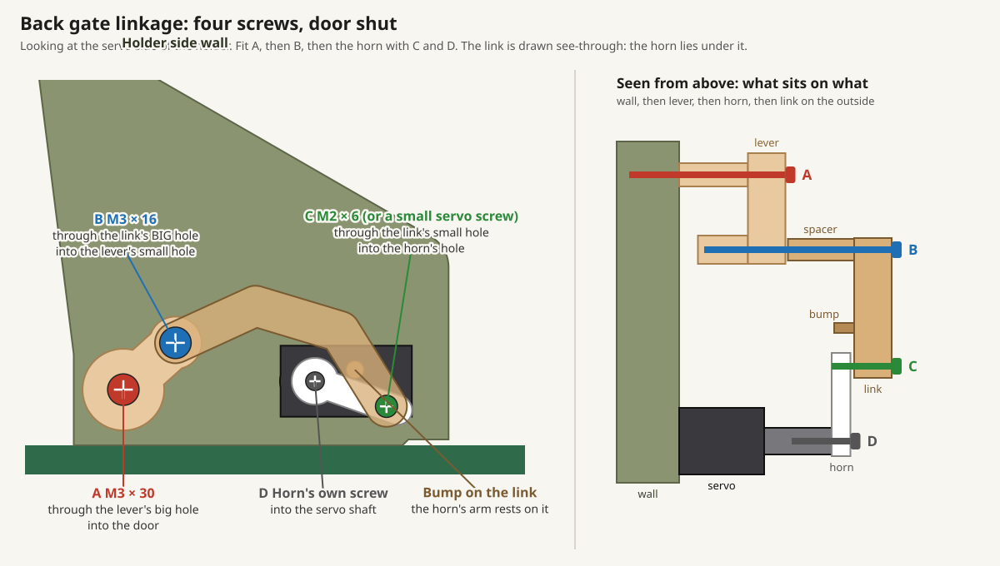

# Printing and assembly (v1)

STLs exported from the Fusion 360 design `BTL Ripe-O-Matic` (Default Project) and **already rotated into print orientation** (`tools/orient_stl.py`): drop them on the plate as they are. Everything fits a 180 × 180 mm bed (Bambu A1 mini). Designed for 0.4 mm nozzle, 0.2 mm layers.

## Print list

| File | Material | How it sits | Settings | ~Time |
|---|---|---|---|---|
| `base.stl` | PLA/PETG | Flat | 3 walls, 15 % infill, no supports. The keyhole studs for the two boxes and for the avocado holder print with it | 3–4 h |
| `driver-box.stl` | PLA/PETG | Flat, keyhole floor down | 2 walls, 10 %, no supports | 45 min |
| `driver-box-lid.stl` | PLA/PETG | Upside down: flat top on the bed, pegs up | 2 walls, 10 %, no supports | 20 min |
| `esp32-case/esp32-case-base.stl` | PLA/PETG | As supplied (floor down) | 2 walls, 10 %, no supports | 1 h |
| `esp32-case/esp32-case-lid-firm-key.stl` | PLA/PETG | As supplied (top down) | 2 walls, 10 %, no supports | 25 min |
| `esp32-case/esp32-case-keycap.stl` + one `mx-adapter` | any | As supplied | default. Print the 1.30 adapter first; 1.25 / 1.35 are looser / tighter on the keycap stem | 10 min |
| `gate-frame.stl` | PLA/PETG | Upright, as supplied (keyholes on the bed) | 3 walls, 15 %, **no supports** (the sled's tunnel and the servo pocket have flat roofs that print as bridges, 45 mm and 16 mm) | 3 h |
| `gate-door.stl` | PLA/PETG | Inner face down, as supplied | 3 walls, 15 %, no supports | 1.5 h |
| `gate-liner-small.stl` (optional) | PLA/PETG | Top face down, hooks up, as supplied | 3 walls, 15 %, no supports | 1 h |
| `gate-lever.stl` | PLA/PETG | Arm down, shaft up, as supplied | 100 % infill | 15 min |
| `gate-link.stl` | PLA/PETG | Flat, spacer and bump up, as supplied | 100 % infill | 10 min |
| `v-holder.stl` *(screwed version, for `base-v1-yoke-slot.stl`)* | PLA/PETG | Lying on the back of its wall (as supplied) | 3 walls, 15 %, **no supports** | 2.5 h |
| `u-yoke.stl` *(old bowl version)* | PLA/PETG | Standing on its cross-bar | 4 walls, 20 %, **supports: on build plate only** (for the servo boss, which overhangs the arm) | 50 min |
| `nest.stl` *(old bowl version)* | PLA/PETG | Upside down: the flat top edge on the bed, the shell's back up | 3 walls, 10 %, no supports. The front lip overhangs at ~45°, which is fine | 2 h |
| `sled.stl` | PETG preferred | Standing on its motor end (already oriented): the nut thread prints vertical like the screw's | 4 walls, 30 %, **no supports** | 1 h |
| `lead-screw-TR10x2.stl` | PETG preferred | Standing, socket end down | 100 % infill or 6 walls, 0.12 mm layers for a smoother thread, **brim** | 40 min |
| `blade.stl` | PLA | Flat on its 12 mm face, stem up | 100 % infill. The magnet pocket faces the bed | 10 min |
| `thumbscrew-knob.stl` *(old bowl version)* | any | Flat | default | 5 min |
| `pad-TPU.stl` | TPU 95A | Socket down, dome up | 2 walls, 15 % | 10 min |
| `nest-liner-TPU.stl` *(old bowl version)* | TPU 95A (or skip: use 3 mm craft foam) | Upside down, same as the nest | 2 walls, vase-ish, **brim** (it stands on a 2 mm edge) | 1.5 h |
| `servo-horn-v2.stl` *(old bowl version)* | any | Flat | default | 5 min — **v2 only** |

**The avocado holder** is a V-shaped corner with a door for a back wall (`gate-*.stl`, made by [`../../tools/back_gate.py`](../../tools/back_gate.py), which also checks every fit and every motion for collisions). Any avocado from 45 to 80 mm across wedges into the corner, so the pad's push can't roll it; a 70 mm one is pressed exactly at its middle, an 80 mm one 6 mm below it and a 55 mm one 9 mm above. At full travel the sled runs 12 mm under the floor, in a tunnel with 5 mm above it and 6 mm beyond it. For small avocados (45 to 65 mm) drop in `gate-liner-small.stl`: it makes the floor 8 mm thicker, so a 57 mm one is pressed at its middle. Tilt it, hook its two front hooks over the floor's front edge, lower the back; lift the back to take it out. A servo tucked under the floor opens the door: it folds down level with the floor and the avocado rolls out the back, onto your own ramp into a basket. The frame clicks onto four studs on the base, so `base.stl` has them now (the old yoke slot and its screw holes are filled). Made for the V45 sled and blade with **Max travel 42** (the firmware's default); don't go past 46 with it.

Older parts kept for anyone who built them: `base-v1-yoke-slot.stl` (the base with the screw-down slot), `v-holder.stl` (a fixed V that screws into that slot, no gate) and the original hanging bowl (`nest.stl`, `u-yoke.stl`, knob, liner).

Print the base and the sled first and test the slide before printing the rest. If the sled binds, scale it 99.5 % in X/Y or sand the lips. The sled's nut is threaded only for its first 10 mm at the motor end (the rest is a Ø10.8 clearance bore), since a 50 mm long printed nut got tighter and tighter as the screw went in. If the screw still binds, reprint the screw with an X–Y contour compensation of −0.15 mm (Bambu Studio: the object's *Quality → Precision* settings) rather than scaling it, so the motor socket stays 5.0 mm; 0.12 mm layers and a random seam help too.

**Experimental printable thread:** the TR10×2 thread prints poorly standing up. A 45° V thread with the same 2 mm lead is being tested in [`v45/`](v45/); see [`../printable-thread.md`](../printable-thread.md) for the exact profile, tolerances and test results.

**The boards live in two boxes** that slide onto keyhole studs on the base: the ESP32 in BTL's *ESP32 case v6* (`esp32-case/`, with the keycap on the lid for the BOOT button), the ULN2003 in the driver box. Stud and keyhole dimensions, positions and how the boxes go on: [`../keyhole-mount.md`](../keyhole-mount.md). Any box with those two keyholes fits either spot. The four corner ears have keyholes for screwing the base to a shelf (details in the same file).

If you re-export from Fusion, run `python3 tools/orient_stl.py` afterwards to put the new files back into print orientation.

## Hardware

| Qty | Item | Where |
|---|---|---|
| 2 | M4 × 8 (or M3 × 8 with nuts) | 28BYJ-48 ears (35 mm apart) into the motor plate; plate holes are 3.5 mm so M4 self-taps |
| 1 | MG90S servo (metal gear; an SG90 works but is near its limit) | The back gate. Comes with horns and screws |
| 1 | M3 × 12 | Door hinge pin, through the plain side wall into the door |
| 1 | M3 × 30 (or × 25) | Through the lever's shaft into the door |
| 1 | M3 × 16 | Link pivot: through the link into the lever (the link turns on the shank) |
| 1 | M2 × 6 self-tapping (or a spare servo screw) | Through the link into the horn's hole 13 mm from the centre |
| 4 | M3 × 6 to 8 | Only for the screwed `v-holder.stl` on `base-v1-yoke-slot.stl` |
| 1 | M3 × 10 | Blade clamp, from the front of the riser, self-taps into the block |
| 2 | M5 × 20 hex-head (or socket) | Old bowl version only: the nest pins. One gets the printed knob on its head; one plain |
| 1 | 3 × 2 mm magnet | Blade back face, in the shallow pocket at pad height |
| 1 | SS49E hall sensor | Post front pocket, legs out the top |

Each box drops over its pair of studs 9 mm short of its final spot and slides home until it clicks (ESP32 case first, sliding toward the motor end; then the driver box, sliding toward the channel) (the cone under each stud head pulls it flat, two little nibs in the slots hold it), lift the lid, put the board in. Nothing on the base needs to match your particular boards; only the box does. Details: [`../keyhole-mount.md`](../keyhole-mount.md).

## Assembly order

1. Press the motor's shaft boss through the plate hole from behind and screw the ears down.
2. Slide the sled into the channel from the nest end, runner pads down.
3. Thread the lead screw through the sled's nut from the nest end, pass its socket through the end-stop hole and push it onto the motor shaft (D-socket, push fit; no glue needed, because the firmware never runs the sled into the end stop). If it's loose enough to fall off, a drop of glue.
4. Drop the blade into the riser slot and fit the clamp screw from the front. Glue the magnet in its pocket on the blade's back, pole marked.
5. Hall sensor in the post pocket, legs up, printed face out (the V45 sled's pocket is a dovetail the sensor slides down into, no glue; the original sled needs a drop of glue); wire it.
6. Press the pad onto the stem.
7. **The gate**, on the bench before it goes on the base (the servo side is the side wall with the rectangular hole; it ends up on the board side):
   1. Hold the door between the side walls, rounded hinge edge down in the corner. Push the lever's shaft through the round hole in the servo-side wall into the door's D-shaped socket and fix it with an M3 × 30 through the lever (× 25 also holds). Put an M3 × 12 through the other wall into the door as the hinge pin. Snug, not tight: the door must swing freely.
   2. Feed the servo's cable into the rectangular hole: it turns into the notch at the closed end, runs behind the servo and out under the floor's front edge. Push the servo in until its tabs sit on the wall (shaft at the end nearer the door), and fix it with its own two screws. **Leave the horn off.**

   

   3. Screw the link onto the lever's pin with an M3 × 16 through the link's larger hole, round spacer toward the lever. It must turn freely on the screw.
8. **The frame onto the base:** lower it over the four studs at the avocado end, 9 mm toward the pad from where it ends up, and slide it back until it clicks. The pad pushes it in the locking direction. To take it off, slide it toward the pad and lift. (If you screw the base to a shelf, do that first: the linkage sits over one corner's keyhole.)
9. **Servo wiring:** orange (signal) to **D25**, red to **VIN**, brown to **GND**.
10. **Set the servo up** (Settings → *Back gate*): turn on **Back gate fitted** and save. Then:
    1. **Direction:** push a horn on loosely and tap **Open the back gate**. Looking at the horn, opening must turn it **counter-clockwise**. If it turns clockwise, set **Shut angle 160** and **Open angle 37** and save. After the test the servo rests at the shut angle.
    2. **Horn:** take the horn off. Shut the door by hand. Put the horn back on pointing straight away from the lever's pin, so it lies under the link with its hole 13 mm from the centre under the link's small hole, and its arm just touching the little bump under the link. Join link and horn with an M2 × 6 through the link into that hole, then fit the horn's own screw.
    3. Tap **Open the back gate**: the door folds down, waits, and comes back up. It is locked when the horn's arm rests against the link's bump; if it stops short of the bump or strains against it, change the shut angle a few degrees.
    4. Optional: **Drop ripe avocados into the basket** opens the gate on its own after a reading that says ripe.
11. Leave **Max travel** at **42** (the default; if you set 37 for the old bowl, put it back). Redo the blade calibration (jar in the V, touching the pad): the holder is part of what it measures.
12. Older versions instead: the screwed `v-holder.stl` (four M3 × 6–8 from below into `base-v1-yoke-slot.stl`), or the hanging bowl (liner into the nest, U-yoke into the slot, nest on two M5 bolts, knob on one).
10. Boxes: click the ESP32 case onto the studs on the board side (USB opening toward the motor end) and the driver box onto the studs on the other side. ESP32 on its pins in the case, ULN2003 on the ledges in the driver box.
11. Wire per [`../wiring-guide.md`](../wiring-guide.md) (step by step, with a picture) or `../README.md` (the 0.1 µF capacitor on the hall sensor output is optional): the six driver wires leave the driver box through its motor-end notch, go round the end of the base and enter the ESP32 case through the USB opening next to the plug; the hall wires use the same opening. The motor's ribbon plugs into the ULN2003 through the driver box's channel-side notch. Snap both lids on; keycap on the ESP32 lid.

## v2

Servo boss, M2 holes and the horn pocket are already in the yoke. Add the SG90, press the servo horn onto the bolt head on that side, and plug the servo into GPIO 25.
