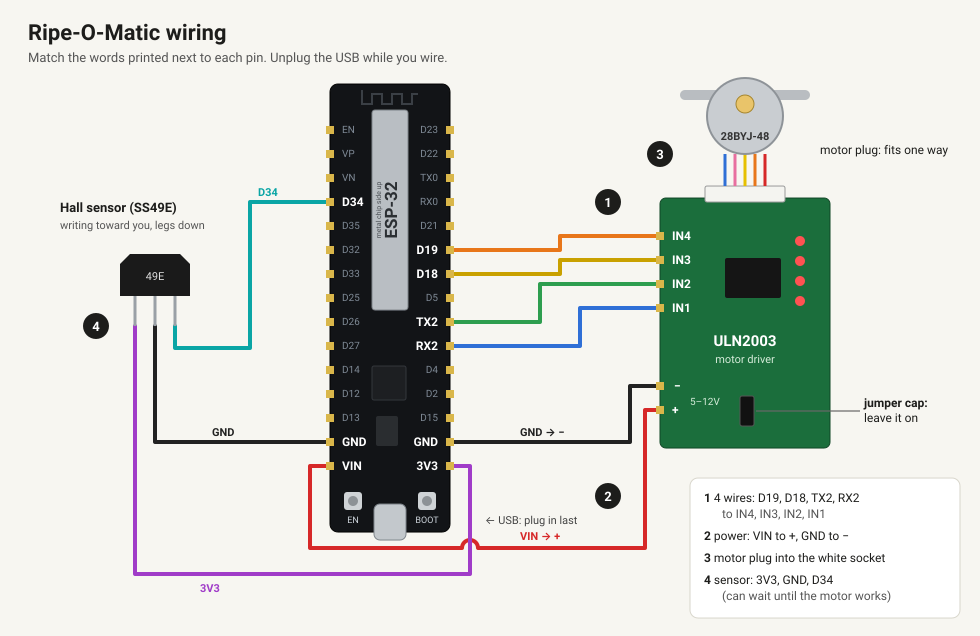
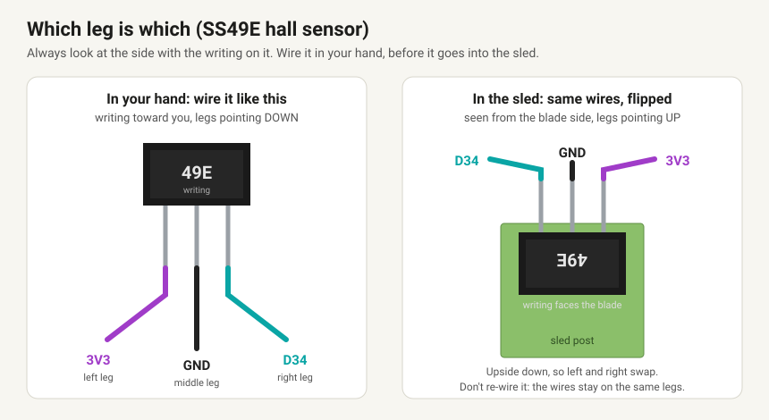

# Wiring, step by step (no electronics experience needed)

No soldering. Every wire just pushes onto a pin. You need **9 female-to-female jumper wires** ("dupont" wires, the kind with a little black socket on both ends) and about 15 minutes.

**Wire colour doesn't matter.** The board can't tell colours apart; only which pin a wire goes to matters. If you have red and black, use red for power (VIN) and black for ground (GND) so you can spot them at a glance.

**Find pins by the words printed next to them**, not by counting. The picture shows where they are on the usual 30-pin ESP32 board, but board makers sometimes shuffle them. `RX2` and `TX2` are this board's names for GPIO 16 and 17.

**Keep the USB cable unplugged until the end.**

## 1. Four wires from the ESP32 to the motor driver

| ESP32 pin | Motor driver (ULN2003) pin |
|---|---|
| `D19` | `IN4` |
| `D18` | `IN3` |
| `TX2` | `IN2` |
| `RX2` | `IN1` |

These must go in exactly this order. If two are swapped, the motor hums or shakes instead of turning.

## 2. Two power wires

| ESP32 pin | Motor driver pin |
|---|---|
| `VIN` | `+` (next to the text "5-12V") |
| `GND` | `−` |

Any `GND` pin on the ESP32 works; there are two. Leave the little **jumper cap** on the motor driver where it is: it's the motor's power switch.

## 3. Plug in the motor

The motor's white plug goes into the white socket on the motor driver. It only fits one way round.

## 4. The hall sensor (three wires)

You can do this after the motor test. If you do the motor test first, see the tip below.

Hold the sensor with the **side with writing on it facing you and the legs pointing down**. From left to right:

| Sensor leg | ESP32 pin |
|---|---|
| left | `3V3` |
| middle | `GND` |
| right | `D34` |

Use `3V3` here, **not** `VIN`: the sensor's signal has to stay at 3.3 V or less for the ESP32. Then slide the sensor into its pocket on the sled, writing facing the blade, legs up. It clicks into a dovetail and needs no glue. If the sensor's readings ever jump around, an optional 0.1 µF capacitor (marked "104") between its right and middle legs calms them. Most builds don't need it.

> **Testing the motor before the sensor is wired?** Put one jumper wire from `D34` to a `GND` pin for now. The machine watches the sensor during every move and stops if the reading jumps. A pin with nothing on it gives random readings, which would stop the motor for no reason. Take this wire off when you connect the sensor.

## 4b. The back-gate servo (three wires)

Only if you built the holder with the back gate. The servo's plug has sockets, so use **male-to-female** jumper wires: male end into the servo's plug, female end onto the ESP32.

| Servo wire | ESP32 pin |
|---|---|
| orange (signal) | `D25` |
| red (power) | `VIN` |
| brown (ground) | `GND` |

`VIN` and both `GND` pins already have a wire on them, so red and brown have to **share**. Use a Y-splitter jumper (one socket to two) on each, a mini breadboard, or twist/solder the servo's red into the driver's `VIN` wire and its brown into a `GND` wire and tape the joints. Red goes to `VIN`, never `3V3`: the servo needs 5 V.

**Push-on wires slip off easily**, especially the power wires when the boxes go on. Once everything works, hold them with a small dab of hot glue or a strip of tape across each board's connectors (hot glue peels off cleanly later).

## 5. Power on and check the motor

1. Plug the USB cable into a computer or phone charger. The LEDs on the motor driver may blink once.
2. If the ESP32 is brand new, flash it first: [web installer](https://btltech1.github.io/ripeomatic/install/) (Chrome or Edge).
3. Open [http://ripeomatic.local](http://ripeomatic.local) on a phone or computer on the same Wi-Fi.
4. Press **1 ▶**. The sled should move 1 mm **away from the motor** (toward where the avocado sits), and the four LEDs on the driver flicker.
5. If it moved **toward the motor**, accept the "flip direction" prompt (or turn on `motor_invert` in Settings) and try again.
6. **Set home** (once): jog the sled toward the motor with ◀ until it just touches the end stop, then tap **Set home here**. From then on the machine counts every step from that spot, and **Home** brings the sled back there.

Using the V45 sled and blade (from [`stl/v45/`](stl/v45/))? Set **Max travel** to **37** in Settings first.

## If something's wrong

| What you see | Most likely |
|---|---|
| Status says "home" or shows a position, but the number doesn't change and nothing moves | A power wire (`VIN` / `GND`) has come off |
| Nothing moves, driver LEDs stay dark | `VIN` / `GND` wires, or the jumper cap is off |
| LEDs flicker but the motor only hums or shakes | `IN1`–`IN4` are in the wrong order (check step 1) |
| Motor turns but the sled goes the wrong way | Direction flip (step 5) |
| "Unexpected force" and the motor stops | Sensor not wired and no `D34`-to-`GND` wire, or the sensor's legs are in the wrong pins |
| `ripeomatic.local` doesn't open | Phone on a different Wi-Fi. Some Android phones can't open `.local` addresses: use the ESP32's IP address from your router's list of devices instead |
| Sensor reading never changes when you press the pad | Sensor in backwards (writing must face the magnet), or left and right legs swapped |

The full technical version (pin numbers, why these pins): [`README.md#wiring`](README.md#wiring).
